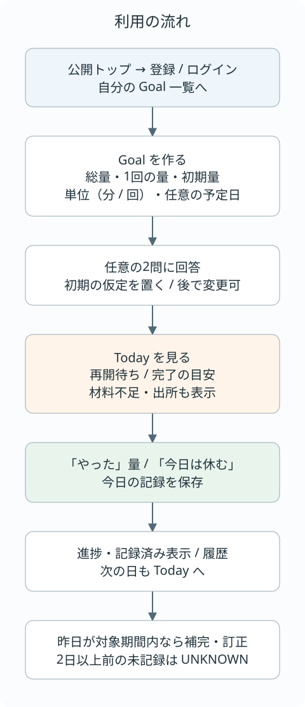
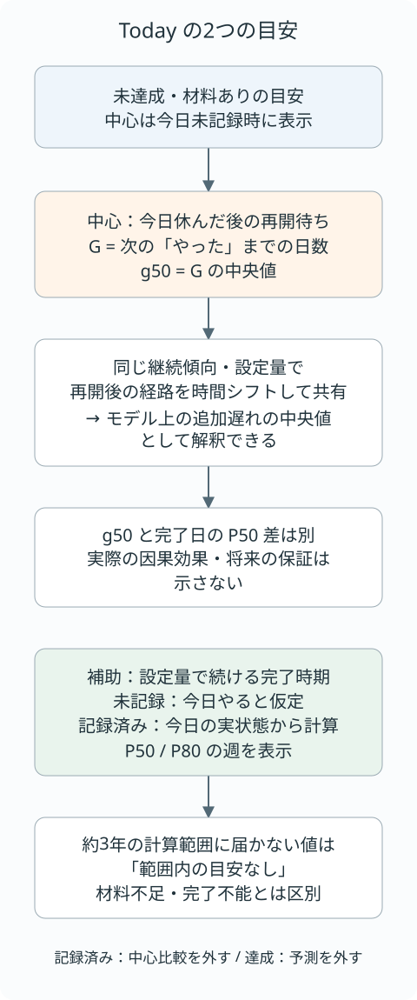
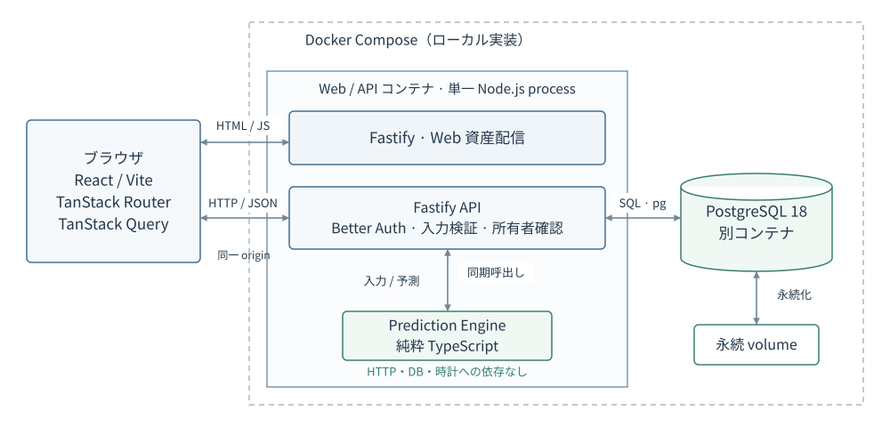
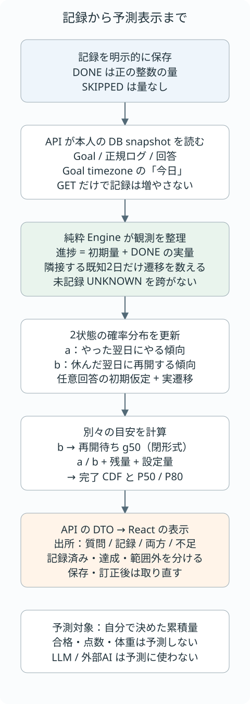

# Future ROI

**今日サボると、ゴールは何日遠ざかる？**

毎日取り組みたい学習・読書・運動などの記録から、今日休んだ後の再開待ちと、自分で決めた累積量への到達時期を見える化する Web アプリです。JOGI HACK 2026 に参加する3人チームで開発しています。

[利用の流れ](#利用の流れ) · [予測の読み方](#todayの目安の読み方) · [構成](#システム構成) · [起動](#開発基盤のセットアップと確認) · [検証と限界](#検証と限界)

## 何を解決するか

「今日はやらなくてもいいか」と感じるとき、今日の選択が先の予定にどうつながるかは見えにくい。Future ROI は、単なる達成率に加えて、**休んだ後の再開傾向を日数の目安で示す**ことを目指します。この表示が行動判断に役立つかは、まだ実ユーザーで検証していません。

対象は、毎日1回の実行機会があり、量を「分」または「回」で表せる行動です。たとえば「英語学習を合計3000分、1回30分」。ここでの達成は設定した累積量への到達であり、試験合格・点数・体重の予測ではありません。[問題・対象・意味の範囲](docs/product-spec.md#product-overview)

## 現在の状態

2026-10-11、main `3e5d9fb` を基準に説明しています。開発期間は 2026-09-19〜2026-10-12、コードフリーズは 2026-10-12 です。

| 区分 | 現在地 |
| --- | --- |
| main の実装 | 登録・ログイン・ログアウト、本人の Goal 管理、今日の記録、昨日の補完・訂正、履歴、Today の予測・出所表示 |
| ローカルで起動できる構成 | Docker Compose の単一 Web/API コンテナ＋PostgreSQL。公開用 bundle のローカル検証入口もある |
| 公開・製品受入 | 公開 URL、HTTPS・実クラウドの認証/DB/負荷、最終 UX 受入は未完了。[公開前の確認](docs/operations/release-demo.md) |
| 追加機能 | 本人向け予測保存・実績照合は main にあるが**既定 OFF**。[R-12](docs/product-spec.md#本人向けの予測保存実績照合r-12既定off) |
| 開発中 | [#244](https://github.com/jogi-hack-2026-team/jogi-hack-2026/issues/244) の量入力・保存後表示、[#227 / PR #238](https://github.com/jogi-hack-2026-team/jogi-hack-2026/pull/238) の実験的な本人学習比較。基準 main の実装紹介には含めない |

実画面の画像は今回未掲載です。量入力・保存後表示の仕上げ後に、確定した実装を動かして撮影する範囲を残しています。以下の画像は説明図です。

## 利用の流れ

1. 登録・ログインして、自分の Goal を作成します。総量、1回の量、開始前に終えた量を設定し、任意で到達予定日を加えます。
2. 近い行動・量についての2問に任意で答えると、初期の仮定から見通しを始められます。未回答や「分からない」を本人の中間回答として扱いません。
3. Today で目安を読み、「やった」量または「今日は休む」を保存します。保存後、再取得が成功すると記録済みの表示に切り替わります。再取得に失敗した場合は、保存済み・更新待ちの状態を表示します。
4. 昨日が記録開始日以降なら補完・訂正できます。2日以上前の未記録は不明のまま残します。履歴はカレンダーで確認できます。



[編集用 draw.io](docs/diagrams/user-flow.drawio) · [画面と状態の仕様](docs/design.md) · [機能からコード・テストをたどる](docs/change-map.md#アプリの仕様と実装)

## Todayの目安の読み方

**中心の g50 は、今日休んだ後、次に再開するまでの待ち日数の中央値です。** 同じ継続傾向・設定量で、再開後の経路を時間シフトして共有するモデルでは、累積量への到達が遅れる日数の中央値とも解釈できます。今日やる場合と休む場合の「完了日中央値どうしの差」ではありません。[Product P-21](docs/product-spec.md#p-21-todayの朝焼け山並み案)

補助の完了予測は、未記録なら「今日、設定量をやる」と仮定し、記録済みなら今日の実状態から計算します。今日の実量を二重に数えず、明日以降は設定量で続ける仮定で、必要回数への到達分布から P50 / P80 の週を示します。P80 はモデル上で累積確率が80%へ届く目安であり、実際の80%達成保証ではありません。約3年の計算範囲で届かない場合は、材料不足と区別して「範囲内の目安なし」と表示します。



[編集用 draw.io](docs/diagrams/today-meaning.drawio) · [表示・不足・範囲外の規則](docs/product-spec.md#today-decision画面の表示仕様)

## システム構成

以下は**ローカル Docker の実装構成**です。ブラウザの React SPA と API は同一 origin。Fastify が Web 資産と業務 API を配信し、認証・所有者確認・DB I/O を担当します。予測は API が純粋な TypeScript パッケージを同期で呼びます。



[編集用 draw.io](docs/diagrams/system-architecture.drawio) · [正式な構成と判断](docs/architecture.md#system構成)

| 境界・技術 | この構成で担うこと・理由 |
| --- | --- |
| React / Vite / TanStack Router・Query | 画面・遷移・取得状態を `apps/web` に置く。API から受けた値の表示と入力を担当する |
| Fastify / TypeBox / Better Auth | 認証・入力検証・所有者条件・公開 DTO を `apps/api` にまとめる。同一 origin の Cookie と変更要求の Origin 確認を保つ |
| PostgreSQL / pg | Goal・1日1件の正規記録・回答版を保存。DB 制約と transaction で保存時の整合性を扱う |
| 純粋 TypeScript Engine | HTTP・DB・時計から分け、同じ入力を独立した数値オラクルと照合できるようにする |
| 2状態 Bayesian Markov | 「やった翌日」と「休んだ翌日」を分ける、説明可能な最小モデル。連続休みの長さの効果や成果そのものは表さない |
| npm workspaces / Docker / Node 標準テスト | Web・API・Engine の3 packageを同じ lockfileで管理。既存の Node テストを使い、実行環境と起動順を再現する |

採用理由・比較案・弱点は [Architecture D-23](docs/architecture.md#d-23)、[モデル判断](docs/prediction/decision-log.md)、[同期実行と再検討条件 D-28](docs/architecture.md#d-28)へ。ローカルでは Node 24.21.0、TypeScript 5.9.3 を固定しています。各ライブラリの版は [package-lock.json](package-lock.json) と [版固定の記録](docs/architecture.md#2026-10-06の版固定と起動構成)を参照してください。

**公開は別の計画です。** Vercel Hobby の Web assets / Fastify Function と Neon Free が条件付き第一候補で、Docker コンテナを公開済みという意味ではありません。公開用 entry・bundle はローカル検証済みですが、実アカウント・費用条件・HTTPS・Cookie・DB休止復帰・負荷は未確認です。[Deployment](docs/architecture.md#deployment) · [公開用 bundle 手順](docs/operations/vercel-bundle.md)

## 記録から予測表示まで

保存した DONE の実量を進捗へ加算し、隣接する既知の2日から継続・再開の確率分布を更新します。未記録を「休んだ」に置き換えず、初期量や質問回答を過去の記録へ加算しません。回答の仮定と実績の出所は表示上でも区別します。



[編集用 draw.io](docs/diagrams/prediction-data-flow.drawio) · [短いコード trace](docs/change-map.md#コードを読むための短いtrace) · [Engine の入口とテスト](packages/prediction/README.md)

## 検証と限界

| 確認する範囲 | 再実行・根拠 |
| --- | --- |
| 型・API/DB・Web・build | [Application CI](.github/workflows/application.yml)。API は実 PostgreSQL で確認し、コンテナの起動・保存・データ保持も smoke する |
| 数値の整合性 | [Engine CI](.github/workflows/prediction.yml)、[独立オラクルと不変条件](packages/prediction/README.md#ローカル検証)。全経路との照合・境界・UNKNOWN・量の単調性など |
| 実ブラウザの状態境界 | [Web browser 回帰](apps/web/tests/session-cache.browser-check.mjs)。ローカルの標準テストでは省略され、実行には Chrome / Edge または `TEST_BROWSER` が必要。CI はブラウザも実行 |
| 文書・参照・設定 | [Foundation CI](.github/workflows/foundation.yml)、下のローカル check。図の XML/SVG と同期検査は [図の保守手順](docs/diagrams/README.md) |

CI や数値テストの成功は、実ユーザーでの予測精度・需要・行動改善を示しません。測定は入力・環境・実行元 SHA に限定して読みます。[検証の索引](docs/prediction/experiment-history.md)から、成功だけでなく失敗と未確認もたどれます。

- 合成記録は数値・仮定の検証用です。OULAD などの外部 proxy 研究は、製品の実利用データと別に扱います。main の数理テストは repository から実行できますが、研究記録に含まれる元データ・全 trace は同梱していないため、外部実験全体をこの repository だけで再現することはできません。
- 回答から置く初期仮定は、質問で真の確率を測れたという証拠ではありません。
- 現行モデルは一定の継続傾向と1回の設定量を仮定します。標準モデルの事後更新を、自動的なモデル改良・誤差補正の採用と呼びません。
- 同期計算は同じ API process の他要求を待たせ得ます。単体・ローカル負荷の結果を公開先の性能保証へ換算しません。
- 公開受入、実ユーザーの理解・効果確認、長期の復帰・退会・データ寿命の判断が残ります。[残課題の入口](docs/change-map.md#確認記録と残課題)

## チームの成果と読みどころ

個人の担当・レビュー実績は、各 Issue の Assignee、PR の差分・作者・レビュー記録で確認できます。本 README はチーム成果を紹介し、個人が全体を担当したとは記載しません。

| 成果 | 読みどころ |
| --- | --- |
| [Engine #90](https://github.com/jogi-hack-2026-team/jogi-hack-2026/issues/90) | 説明可能なモデル、純粋関数の責務分離、独立オラクル、完了分布の数値計算 |
| [API・基盤 #89](https://github.com/jogi-hack-2026-team/jogi-hack-2026/issues/89) | 所有者境界、量・設定版・再送の保存契約、実 DB 回帰、Docker 起動・終了 |
| [画面 #88](https://github.com/jogi-hack-2026-team/jogi-hack-2026/issues/88) | Goal → Today → 記録の導線、材料不足と範囲外の説明、通信・競合・session 状態の回復 |
| [仕様と実装の対応表](docs/change-map.md) | 要件・判断・実装・テスト・実施結果をつなぐ開発記録 |

## ライセンス

この基準 main にはリポジトリ全体の LICENSE ファイルはありません。再利用・再配布の許諾条件は未設定です。依存パッケージ・フォントなどのライセンスとは分けて確認してください。研究で参照する [OULAD の公式データ説明・ライセンス](https://research.stem.open.ac.uk/ouanalyse/open-dataset-more/#rights-statement-and-license)は CC BY 4.0 です。この文書更新でデータセットは取得・同梱していません。

<details>
<summary>現在の判断・実装状況の詳細（開発者向け）</summary>

| 区分 | 内容 |
| --- | --- |
| 確定 | 大会：JOGI HACK 2026 / 対象：Webアプリケーション / チーム：3人 |
| 確定 | 開発期間：2026-09-19 ～ 2026-10-12 / コードフリーズ：2026-10-12 |
| DECIDED | 2026-09-30にProductを「Future ROI（今日サボると、ゴールは何日遠ざかる？）」に決定し、要件・MVP Scopeを確定した。[Product Spec](docs/product-spec.md#現行状態2026-09-30) |
| DECIDED（提出版の表示） | 2026-10-11に依頼者が、#199／PR #202・#221／PR #223でmainに入ったTodayと全画面の表示を正式決定した（#232）。旧Hero/Coreコピーを保持。g50は再開待ちであり、同じ継続傾向・設定量と再開後経路共有のモデル上の追加遅れ中央値とも解釈できる（完了日のP50差・因果効果とは別）。範囲・比較した案・未確認の理解確認と最終UX受入は[Product Spec P-21](docs/product-spec.md#p-21-todayの朝焼け山並み案)へ |
| DECIDED（Scope・分担） | 2026-10-05、[R-11のMust追加と責任分界をチーム採択](docs/product-spec.md#p-15-質問由来の見通しのmust追加方針)。MustはR-01〜R-11。2026-10-07の依頼者承認範囲の回答保存・公開Engine／GETは#133、質問入力・回答版の競合復旧とTodayの出所別表示は#137・#81でmainへ接続済み。[D-26](docs/architecture.md#d-26)の当時のOPEN履歴と現契約を区別し、実装を製品受入・実ユーザーでの校正済みとは扱わない |
| DECIDED | 現行の実績由来の予測モデル（2状態Bayesian Markov、Beta(2,2)、中心指標はBeta-Geometric分布の中央値）、Data Modelと記載済みの業務API規則。契約の未定義部分・解釈の判断待ちは[Architecture](docs/architecture.md#現行状態2026-09-30)から確認する |
| DECIDED（基本構成） | 2026-10-03のD-23基本構成採用は、FE側のDiscord上の了承についての依頼者報告とBE本人の了承記録に基づく。[採用構成・理由・次の作業](docs/architecture.md#2026-10-03の技術構成合意)。2026-10-05に[npm workspacesと`pg`を追加採択](docs/architecture.md#2026-10-05の追加採択)。当時の合意範囲と、後日の[版固定・API契約](docs/architecture.md#technology-stack)を分けて読む |
| 条件付き第一候補 | Better Authは[D-24](docs/architecture.md#d-24)。公開はFE・BEともVercel Hobby＋Neon Free、ローカルDockerが[D-25](docs/architecture.md#d-25)の第一候補（2026-10-08、本人アカウント・厳密0円・非商用・検証条件付き）。最終採択・配備済み・一般公開や課金の許可ではない |
| mainの実装／受入・公開待ち | [Prediction計算本体・テスト](packages/prediction/README.md)、起動基盤・DB schema/migration・認証・Goal・記録・Today APIと実APIを使う業務画面はmainにある。画面の実装・既存ローカル検証記録と、製品受入・E2E・公開配置の残条件は[対応表の現在地](docs/change-map.md#現在地の読み方)で区別する。未mergeの画面変更をmainの説明へ混ぜない |

コードフリーズ後は、原則としてソースコードと事前提出資料を編集できません。
過去の案・会話・実験コードは採用済みの仕様ではありません。

情報には次の区分を明記します。

- **確定**：チームで明示的に決定済み。
- **候補**：現在検討している選択肢。
- **仮説**：検証が必要な推測。
- **未定**：まだ議論・決定されていない事項。

現時点では文書、4種類のIssue Forms、PRテンプレート、AI向けSkills、Serena設定、miseの共通タスク、文書・設定検証用のGitHub Actionsがあります。
現行のアプリ起動構成（npm workspaces・`apps/api`・`apps/web`・Compose・単一コンテナ・Application CI）は#70で、DBスキーマとmigration（`npm run db:migrate`）は#74で、認証（登録・ログイン・ログアウト、未ログインは401）は#75でローカル実装済みです。Goal API（#76）と記録・Today API（#77、`/today`が純粋Engineを呼ぶ）、Goalの一覧・作成・編集・削除画面（#78）とToday画面（#81）は実APIでローカル実装済みです。今日の記録・変更（#79）と昨日の補完・訂正（#80）も実APIで保存します。公開先（staging）への配置は未実施です。
現行の未決定事項と当時の検証記録への入口は[開発基盤の状態](docs/operations/development-foundation-status.md)で区別しています。
次の案で使える資産と再評価が必要な条件は[引き継ぎの棚卸し](docs/operations/reuse-handoff.md)にまとめています。
実装の棚卸し・調査基準・関連する判断Issueは[仕様・実装・確認方法の対応表](docs/change-map.md)を参照してください。
初めてコードを読む場合は、[記録保存から予測表示までのtrace・用語・テスト入口](docs/change-map.md#コードを読むための短いtrace)から進めます。

Demo Seed（#82）は認証で作成済みのuserIdとtimezoneを明示し、専用2Goalだけを作成・resetします。[実行・再実行・保全の手順](docs/operations/demo-seed.md)を参照してください。公開DBと恒久Demo Accountの作成、Webの通し確認は別途必要です。

</details>

## 開発基盤のセットアップと確認

GitとPowerShell 7を使います。文書・設定チェックの手順は[開発ガイド](docs/DEVELOPMENT_GUIDE.md#13-初回セットアップ)を参照してください。基本構成の採用と認証・公開先の残条件は[Architecture](docs/architecture.md#technology-stack)で確認します。アプリの起動構成はNode 24.21.0に版固定し、[起動・検証手順](docs/DEVELOPMENT_GUIDE.md#アプリを起動検証する)にまとめています。公開先（staging）への配置は未実施です。

Dockerで一式を起動する場合、初回だけ`.env.example`を`.env`へコピーし、ローカル専用の`LOCAL_DB_PASSWORD`と32文字以上の`BETTER_AUTH_SECRET`を設定します。その後は`docker compose up -d --build`でDB health→認証・アプリmigration→単一NodeのWeb/API配信へ進みます。準備完了を待つには`--wait --wait-timeout 120`を追加し、既定の `LOCAL_APP_PORT=8080` なら `http://127.0.0.1:8080` を開きます。ポートを変更した場合はアクセス先も合わせます。hostのNode/miseは不要です。[設定・停止・再起動・失敗時とデータ保持](docs/DEVELOPMENT_GUIDE.md#dockerで一式を起動する)、[hostのホットリロードとの使い分け](docs/DEVELOPMENT_GUIDE.md#dockerとhost開発の使い分け)を参照してください。

Docker Engine と Compose が使える環境で、repository root から実行します。初回の `.env` 作成と編集を終えてから起動してください。既存 `.env` は上書きしません。

```powershell
# 初回のみ。次に .env のローカル専用2項目を編集する
if (-not (Test-Path .env)) { Copy-Item .env.example .env }
# 設定を終えた後、DB・migration・Web/APIの準備完了を待つ
docker compose up -d --build --wait --wait-timeout 120
if ($LASTEXITCODE -ne 0) { throw "Compose の起動に失敗しました" }
# 既定 LOCAL_APP_PORT=8080 の例。変更した場合は URL も変更する
# 正常時は status=ok
Invoke-RestMethod http://127.0.0.1:8080/api/health
```

起動に失敗したら [失敗時の確認](docs/DEVELOPMENT_GUIDE.md#dockerで一式を起動する)で設定・DB health・migration のどこで止まったかを確認します。停止は `docker compose down`。DB volume を残すため、通常の停止に `-v` を加えません。この文書更新では Docker 起動を再実行していません。

導入済みの環境では、リポジトリのルートで `mise run --skip-tools check` を実行します。文書・設定を検査し、成功時は `PASS:` が表示されます。
miseがない場合は、PowerShell 7で `pwsh -NoProfile -File scripts/check-foundation.ps1` を実行すると同じ検証ができます。
Hook（コミット前に走る処理）の導入はローカル設定を変更するため、[初回セットアップ](docs/DEVELOPMENT_GUIDE.md#13-初回セットアップ)を読んで別に行います。

アプリ全体は `npm ci` → `npm run typecheck` → `npm test` → `npm run build` で検証します（Node 24.21.0 / npm 11.19.0、開発依存もインストール。miseなら `mise install` の後に `mise run test` 等）。APIテストはPostgreSQLを使い、shell の `DATABASE_URL` がなければ開発依存の `embedded-postgres` でテスト用クラスタを一時起動します。テストは root の `.env` を自動では読みません。`DATABASE_URL` を設定する場合はテスト専用の接続先を使い、ランダム名のテスト DB を作成・削除できる権限が必要です。手順・実ブラウザの実行条件は [開発ガイド](docs/DEVELOPMENT_GUIDE.md#アプリを起動検証する) を参照してください。[Application CI](.github/workflows/application.yml)は同じ4段階とコンテナのsmoke testを実行します。

Prediction単体は[Docker検証手順](packages/prediction/DOCKER.md)で、hostにNodeを追加せず型検査・テスト・接続例・T-14を実行できます。Secret・DBは不要です。製品全体の起動構成やruntimeの採択とは分けます。

`check`は文書・設定の検証です。Secret・DB・アプリRuntimeは不要です。

本人向けの予測保存・実績照合（#225）は**既定OFF**の追加機能です。[仕様と状態](docs/product-spec.md#本人向けの予測保存実績照合r-12既定off)、[設定・再検証・削除運用の残条件](docs/changes/issue-225-evaluation-verification.md)を参照してください。実データでの有効化や共有DBへの migration 適用は別途判断が必要です。

## 最初に読む順番

1. このREADME：前提、現在の状態、情報の置き場所。
2. [CONTRIBUTING.md](CONTRIBUTING.md)：チーム共通の開発ルール。
3. [開発ガイド](docs/DEVELOPMENT_GUIDE.md)：環境準備からIssue・ブランチ・PR・マージ後までの操作。
4. [AGENTS.md](AGENTS.md)：AIへ作業を依頼する際の共通ルール。
5. [AI開発ツールガイド](AI_DEVELOPMENT_TOOLS.md)：MCPとSkillsの使い分け、利用状況。

機能の仕様を知りたい・変更したい場合は、[対応表](docs/change-map.md#アプリの仕様と実装)から「目的・操作・入力や表示の条件・失敗時の動作」を説明する機能文書へ進み、内部処理、関連コード、確認方法をたどります。
正式な設計文書は[Product Spec](docs/product-spec.md)と[Architecture](docs/architecture.md)の2本です。アプリの起動構成とProduct機能の実装状況、比較結果と未検証範囲はArchitectureからたどれます。[開発基盤と作業手順](docs/change-map.md#開発基盤と作業手順)と[配置ルール](CONTRIBUTING.md#仕様文書の配置)も参照してください。

AIは最初にAGENTS.mdを読み、必要な文書とSkillを参照してください。

## 情報の正本

| 情報 | 正本 |
| --- | --- |
| プロジェクト概要、日程、文書の入口 | このREADME。Product・Architectureの状態は下記2正本を参照 |
| Issue / ブランチ / コミット / PR / レビュー / マージ / Ready・Done / Scopeの運用ルール | [CONTRIBUTING.md](CONTRIBUTING.md) |
| 共通ルールを実行する具体的な操作手順 | [開発ガイド](docs/DEVELOPMENT_GUIDE.md) |
| AIの判断範囲、安全性、実装・検証原則 | [AGENTS.md](AGENTS.md) |
| ツールの利用方針、環境依存情報、Skill一覧 | [AI開発ツールガイド](AI_DEVELOPMENT_TOOLS.md) |
| 作業別のAIワークフロー | [.agents/skills/](.agents/skills/) の各SKILL.md |
| 機能・ページ・基盤から仕様、実装、確認方法への対応と棚卸し | [仕様・実装・確認方法の対応表](docs/change-map.md) |
| 個別タスクの背景・目的・範囲・完了条件 | [GitHub Issue](https://github.com/jogi-hack-2026-team/jogi-hack-2026/issues) |
| 現在のStatus・Scope | [GitHub Projects](https://github.com/orgs/jogi-hack-2026-team/projects/1)（アクセス権が必要） |
| 正式Product仕様・要件・Scope・Product Decision Log | [Product Spec](docs/product-spec.md) |
| 正式Architecture・技術候補・DB・Deployment・Architecture Decision Log | [Architecture](docs/architecture.md) |
| 現行基盤の状態と旧設定・検証記録への入口 | [開発基盤の状態](docs/operations/development-foundation-status.md) |
| リリース・提出・デモ | [リリースとデモの手順](docs/operations/release-demo.md) |

仕様・設計・資料の追加先と執筆手順は[ドキュメント運用](CONTRIBUTING.md#ドキュメントと技術判断)を正本とします。過去の草稿・実施結果は[Issue単位の履歴フォルダ](docs/changes/)から探せます。フォルダには新しい正式仕様を置きません。
同じ説明をコピーせず、正本へリンクします。

## 廃止した音楽案の履歴

2026-09-29に廃止した音楽探索案（[Product Spec P-10](docs/product-spec.md#p-10-音楽探索案の廃止)）の記録です。現行Future ROIの仕様・設計・検証ではないため、#200でREADMEの状態表・読む順番・正本一覧からの重複した案内を外し、開発者向けの折りたたみへまとめました。本文と固定履歴は削除していません。

<details>
<summary>当時の記録の参照方法（開発者向け）</summary>

廃止した音楽案の文書・比較PoC・当時の設定は、[固定commit `77c71a5` のtree](https://github.com/jogi-hack-2026-team/jogi-hack-2026/tree/77c71a5f248a4dce4ce9fb8af6619b41541be9d8/archive/music-exploration)から参照します。#188でtracked file 111件を現在の作業ツリーから外しました。Git履歴と当時の採択・失敗・検証結果は保持し、現行アプリの仕様や起動手順へ自動適用しません。

ローカルで調べる場合は、そのcommitの別checkoutから `archive/music-exploration` を参照してください。現行checkoutの設定やDBへ復元して動かす前に、[再利用時の確認事項](docs/operations/reuse-handoff.md)を確認します。

固定履歴のfile内容だけを読むには、`<path>`を当時のrepository相対pathに置き換えて `git show 77c71a5f248a4dce4ce9fb8af6619b41541be9d8:<path>` を実行します。現在の作業ツリーへ書き戻す操作ではありません。

過去の開発基盤の判断履歴は[開発基盤ADR](https://github.com/jogi-hack-2026-team/jogi-hack-2026/blob/77c71a5f248a4dce4ce9fb8af6619b41541be9d8/archive/music-exploration/docs/decisions/0001-development-foundation.md)です。新規Product設計の正本を増やしません。旧音楽案のML Issue向けCodex Harnessは通常の実行タスクとCIから外しました。再利用前の確認事項は[引き継ぎ](docs/operations/reuse-handoff.md)を参照してください。

</details>

## 比較実験の保存範囲

`experiments` は製品runtimeと分け、現在使う検証と過去の比較を次のように扱います。比較実験の保存範囲はこの表を正本とします。過去の成功・失敗・採択理由を現在の製品受入へ読み替えません。

| 実験群 | 配置と用途 |
| --- | --- |
| [question-prior-engine-candidate](experiments/question-prior-engine-candidate/README.md)、[question-prior-contract](experiments/question-prior-contract/README.md) | 現CIの独立数値オラクル・凍結fixtureを使うため保持 |
| [api-mixed-load](experiments/api-mixed-load/README.md) | 実EngineとAPIの能動的な再測定に使うため保持 |
| question-prior-proposal | [固定commitのtree](https://github.com/jogi-hack-2026-team/jogi-hack-2026/tree/77c71a5f248a4dce4ce9fb8af6619b41541be9d8/experiments/question-prior-proposal)へ。historical・reproduced・provenance・rawを一式で保持し、tracked 57件を作業ツリーから外す |
| prediction-model-validation | [固定commitのtree](https://github.com/jogi-hack-2026-team/jogi-hack-2026/tree/77c71a5f248a4dce4ce9fb8af6619b41541be9d8/experiments/prediction-model-validation)へ。旧モデル比較・失敗と修正の根拠を一式で保持し、tracked 22件を作業ツリーから外す |
| question-prior-ui-candidate、architecture-verification | 旧候補UI専用workflowに実行依存があるため今回保持。workflowと必要チェックの確認を含む整理を別途判断する |
