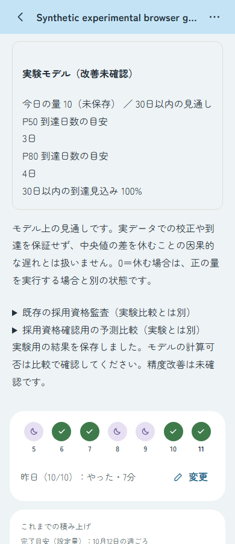
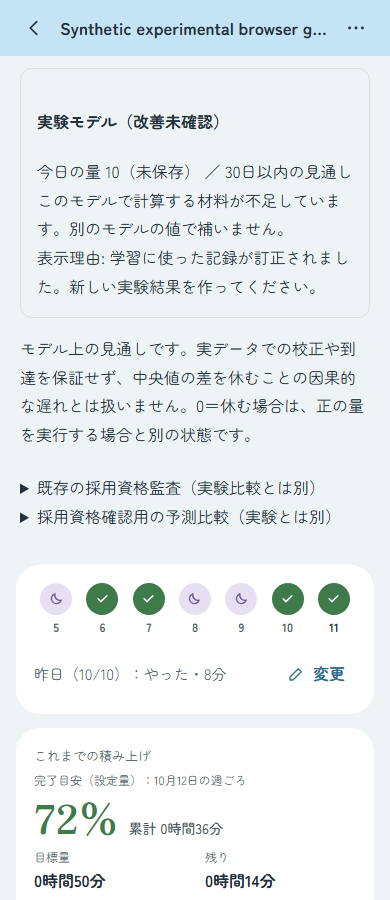

# #227 実験モデルの明示比較：合成環境の検証

標準R11を主表示に残し、別同意と明示操作で本人履歴からfitした実験モデルを、同じ今日の仮の量・30日範囲で比較する。実験結果は採用資格を満たしたものとして扱わず、自動採用しない。[R-13 / P-23](../../product-spec.md)、[D-33](../../architecture.md)、[Design Intent](../../intents/issue-227-record-learning.md)を参照する。

## 基準と確認結果

2026-10-11、main `fba12d361b5260a2ac8342c6267023b46750dfbb` と整合したソースで確認。公開用worktreeへ検証済み53ファイルをbyte一致で移した。元worktreeの開始／終了時159ファイルのhashが一致した全APIテストは、10:43:29–11:14:31 UTCに327/327 PASS（fail/cancel/skip 0）。Engine97/97、Web248 PASS・ブラウザ実行案内の1 skip、別途実行したChrome21/21、各typecheck/buildもPASS。Foundationは111文書・2067ローカルリンクでPASS（文書・設定の検査でありアプリテストではない）。件数は重複する検証範囲なので合算しない。

独立AIレビューでは最終統合差分に重大指摘なし。Dの最終レビューは静的確認とhash／patch照合であり、API327等を再実行したものではない。AIレビューを人間の製品・運用受入に置き換えない。exact HEADのリモートCI結果はPRのChecksで別に確認する。

## 実Appの縦断

確認専用の合成8日履歴・HIGH/HIGH回答を使い、実App・通常BetterAuth・実API・専用embedded PostgreSQLで実行した。数値、qualification gate、採用pointerの注入はしていない。

- ログイン→別同意→実fitのPOST 201→明示比較GET 200。
- 今日の仮の量10／20／0を比較し、標準主表示、active revision 0、業務記録を保持。
- 昨日の実績を通常APIで訂正後、再読取するとINPUT_CORRECTEDで実験値はnull。標準値を実験結果に流用しない。
- 実UIの確認ダイアログから参加解除し、参加と派生artifactを削除。
- Chrome/profile、専用API/DB、一時資格情報を片付けた。最初のdriver失敗は別記録として保全し、fit成功に数えない。

## スクリーンショット

合成Goal・合成ユーザーのAfter画像。既存標準画面のBeforeは本変更で新たに撮影していない。

### 実験値（390×900）

カード全体で、出所、改善未確認、今日の量10（未保存）、30日範囲、P50=3／P80=4、到達見込みが読める。

### 記録訂正後（390×900）

不足・訂正理由・別モデルの値で補わない文章は読める。カード見出しと今日量・horizonは上端で切れており、全カードのpixel確認は未達。撮影前のDOM矩形を画像確認の代わりにしない。

## 未確認・採用資格のHOLD

実データでの精度改善、実際の80%到達率、校正、因果的な遅れ、公開負荷・p95・Vercel CPU、人間の最終UX／運用受入は未確認。公開有効化・本番migration・merge・deployは行っていない。

固定母集団の旧qualification検証は、最適化後の主要48例でINSUFFICIENT40／REJECTED8／ADOPTABLE0、遠方48例も全不足。約190日の証拠成熟と90日派生保持の不整合、回答priorのas-of履歴不足は残る。数値が計算できる範囲の拡大は採用資格の証明ではない。

H<=30、有限32→64 completion CDF refinement、work／欠測guardを維持した。有限診断は連続posterior全CDFの厳密誤差保証ではない。100m guardはDP配列の初期化・clearの見積範囲で、全JS allocation／CPU保証ではない。別の論文ベース合成ストレスは、このPRの採用条件に追加していない。

2026-10-11の追加承認に基づき、[論文を参考にした合成ストレス32履歴](synthetic-stress-v1/README.md)をSupporting資料として追記した。基準モデルは上記PRの初回HEAD。全32平均RPSは方針.128919／legacy.124642で悪化、finite P80の達成率は71.85%。元宣言・補足・全32CSV・小集計・出典を残し、製品コード・採用条件・旧qualification HOLDは変更していない。
